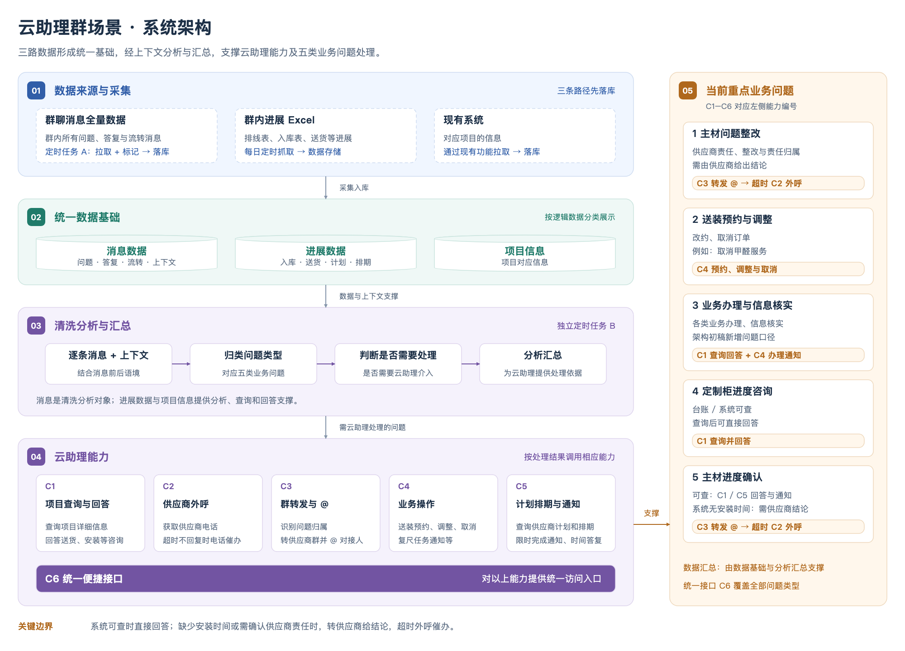

---
tags:
  - 需求
  - 云助理
  - Roomie
  - 架构
date: 2026-11-06
status: draft
source:
  - "[[00.需求/roomie/架构初稿]]"
  - "[[00.需求/roomie/架构整理后]]"
  - "[[00.需求/roomie/云助理群场景提效·Roomie接入初版方案]]"
---

# 云助理 × Roomie 数据架构

> 🔗 飞书：https://beike.feishu.cn/docx/AybudaBfgomHCrxcadUcxGJyndg

## 1. 云助理目前主要在群中解决的 5 类问题

**1. 主材问题整改**——供应商责任类问题（整改、谁负责），需供应商给结论
- 现在的操作：如果是供应商的问题，需要将问题转发到供应商所在的群，并艾特供应商；如果是项目经理的问题，需要通知项目经理。
- 对应功能点：3.1 归类汇总 → 3.3 消息转发 → 3.4 外呼（超时不回）

**2. 送装预约与调整**——改约、甲醛不做了取消订单等
- 现在的操作：需要在luban页面上进行操作（改约和取消），需打开网页跳转多个页面。
- 对应功能点：3.6 业务操作（一期只给入口）

**3. 业务办理与信息核实**——各类办理事项与信息核实
- 现在的操作：需要在现有服务中查询项目所有信息，可能涉及多个服务和多个角色（项目经理、供应商），效率低下。
- 对应功能点：3.5 项目信息聚合查询（+ 3.6 操作入口）

**4. 定制柜进度咨询**——台账/系统可查，可直接回答
- 现在的操作：由于进展不同，需要查询的系统也有很多不同，并且卡点也不一致——可能卡在工人上，也可能考在项目经理上，需要多方查询后才能获得准确消息。
- 对应功能点：3.5 聚合查询（Agent 自动回复台账可查类）

**5. 主材进度确认**——系统依赖供应商数据，需找到供应商要结论
- 现在的操作：和定制柜进度查询比较类似，复杂的点在于涉及多个系统，需要多方确认才能得到准确信息。
- 对应功能点：3.5 聚合查询（无系统数据时）→ 3.3 消息转发 → 3.4 外呼 → 升级北京供应链

## 2. 系统结构

**结构说明**：初步依赖群消息、Excel 表和现有系统中所存的施工项目信息，对云助理提供以下能力（详见 §3 功能点）：

- 项目信息的查询与回答
- 供应商外呼
- 群消息转发
- 具体业务操作
- 计划排期通知与数据汇总

**图示分层**（自下而上）：

- **数据来源层**：群消息（问题数据、报表数据）+ 现有系统（施工项目信息）
- **数据加工层**：LLM 清洗分析 → 归类问题类型；数据整合 → 形成数据基础
- **能力层**：项目信息查询与回答 · 供应商外呼 · 群消息转发 · 具体业务操作 · 计划排期通知与数据汇总
- **应用层**：云助理作业 / Agent 自动回复 / 供应商交互

## 3. 接入Roomie 需要具体实现的功能点

> 以**功能点**为维度撰写：每个功能点先说**要实现什么功能**，再说**具体怎么实现**——优先基于现有系统已有能力做封装，不重复开发。Roomie 平台能力基础：**自定义 Agent、Skill、数据库**。
>
> 🔗 **Roomie 侧提供的开放 API 接口文档**（接入用）：https://beike.feishu.cn/wiki/JFf1wFteCi4gGik4io0crh15nRm ——覆盖机器人、会话、消息服务、聊天记录、聊天消息事件、群、加微各域接口（含测试/生产域名与 IAM 鉴权接入方式），各接口详细文档见该页内 weapons.ke.com 链接。
>
> **优先级排序**（已确认）：① 群消息问题归类汇总 → ② 材料送货进展（数据汇总）→ ③ 消息转发 + 供应商外呼 → ④ 项目信息聚合查询 → ⑤ 业务操作。小节按此顺序编排。

企微群-roomie的信息收集
群消息汇总接入roomie
### 3.1 群消息问题归类汇总（以人为维度集中展示 + 待办提醒）——优先级 ①

**要实现的功能**：获取群消息的上下文，归类群中的问题，对提出的问题进行归类汇总；**以人为维度**将所有问题集中在一个页面对云助理展示；并增加**提醒待办的提示**——哪个群的什么消息长时间没有回复，提醒云助理别忘了处理。

**实现方式**：
1. 通过 Roomie 消息接口获取群消息全量上下文（消息事件实时推送 + 聊天记录定时拉取兜底）；拉取时**记录本次拉取的位置（偏移量/游标），只拉取新增部分**，不每次全量拉取——同一条消息不允许被反复拉取、反复识别问题；
2. LLM 结合上下文对每条消息做**三层清洗归类**（清洗归类规则）：
   - **层1 问题归类**：是否是问题、问题类型（§1 的 5 类问题）、归属项目与供应商——描述性问题属于哪类；
   - **层2 解决方式归类**：归类落点**不是问题类型，而是该问题的解决方式**——查询项目信息 / 问题转接（转供应商群）/ 业务操作 / 外呼（分类需讨论）；
   - **层3 具体行为**（放最后）：该问题解决的**具体行为**——查询哪个订单下的什么信息，或转接哪个供应商群 @ 谁——在层2 决定后填充，作为执行参数；
3. 归类汇总**以人为维度**（按处理人归集其名下全部待处理问题）集中在一个页面（Roomie 侧边栏）展示，云助理集中跟进；
4. **待办提醒**：双向——供应商超时未回提醒云助理外呼；云助理漏答（问题挂着长时间无人回复）提醒别忘处理。

**演进路径（初步方案，已确认）**：
- **一期 · 事后汇总分析**：先事后拉取上下文消息和云助理的解决方式，对问题进行汇总分析——拿到这些数据和问题归类的数量（AI 暂不介入处理链路）；
- **二期 · AI 辅助处理**：拿到一期数据后，结合 AI 对问题进行辅助处理（上文第 2 步三层清洗归类即此期落地形态）；
- **三期 · 配置化自动回复**：支持对某些特定问题进行配置，这类问题通过 AI 自动回复和处理。

甲醛取消--供应链侧看看有无现有能力

**依赖**：Roomie 消息上下文 / 聊天记录接口 + LLM 清洗 + Roomie 侧边栏功能位。

### 3.2 材料送货进展数据（群内 Excel 自动落库 + 每日汇总推送）——优先级 ②

**要实现的功能**：散落在数据回收群的进展数据（排线表、入库表）自动归集入库，每日「明日送货」等汇总自动推送——替代云助理每天盯群、传表、拼文档、发汇总。

**实现方式**：现有工作台小工具逻辑**照搬产品化迁移**（不重新构思规则）：
1. **落库**：数据回收群切企微 + 自动抓取群内 Excel（排线表、入库表）解析落库，不改变仓管/供应链发消息习惯（落库不全落）；
2. **汇总**：按小工具既有拼接规则做汇总分析（含 3 个在线文档数据，取数方式照搬）；
3. **实时查询**：汇总数据同时作为 Roomie 侧边栏功能提供实时查询——PM/云助理不用等每日推送，随时可查。

**依赖**：服务承载（Excel 解析落库）+  Roomie 发消息接口 + 侧边栏功能位。

### 3.3 消息转发（转发问题到供应商群并 @ 对接人）——优先级 ③（待定做）

**要实现的功能**：系统里没有答案、需要供应商给结论的问题，转发到对应供应商群并 @ 对接人。

**实现方式**：
1. 归属路由来自 3.1 的问题归类结果（问题 → 解决方式→ 供应商映射）；
2. LLM 生成转发文案（问题原文 + 项目信息 + 期望回复时间）；
3. **半自动（默认）**：云助理在问题汇总页看到归属与文案，一键转发；**自动化**：问题确认后自动调 Roomie 发消息接口转发——供应商群从微信切企微后启用，开关切换无发版。

**依赖**：Roomie 发消息接口（支持 @ 指定人）+ 项目 / 供应商映射。

### 3.4 供应商外呼（人工触发、系统承接）——优先级 ③

**要实现的功能**：供应商超时不回复时，云助理打电话催——话费统一承担、通话留痕。

**实现方式**：接入 Roomie 外呼电话能力，接入形态两种（已确认）：**对外提供接入 Roomie 的 Agent，拿到指定供应商的电话一键外呼**，或**由 Roomie 云助理 Agent 直接查询调用**。**不做自动化**——云助理收到超时提醒后人工决定发起外呼（人工触发、系统承接通话），通话记录回流留档。可结束通话，记录AI转写，记录本次沟通的关键内容，并留存记录。后续可以通过agent自动拨打。

**依赖**：Roomie 外呼电话能力（含通话记录）。
能聊天、工作台接外呼（两个位置）

### 3.5 项目信息聚合查询（单页面查全所需信息）——优先级 ④

**要实现的功能**：云助理在单个页面上查询到答疑所需的全部信息（项目进展、主材进度、送货排期、供应商信息等），替代现在开多个系统多个页面挨个查。这个可以实现两种方式：一种是Agent的自动回复，一种是项目经理快速查询。

**实现方式**：根据现在系统中已有的能力，通过**封装主材订单考核、送货、供应链的功能接口**，对查到的信息进行汇总展示：
1. 新服务统一封装上述现有功能接口，聚合为「项目详情」查询能力（项目进展 + 主材进度 + 送货/排期 + 供应商信息）；
2. Roomie Agent 配置 Skill 调用该能力——PM 群内台账可查的咨询类问题（定制柜进度、主材进度等）由 Agent 直接自动回复，云助理无需人工查一遍台账再回；
3. 云助理人工答疑时，在 Roomie 侧边栏看到同一份聚合数据，一站式查询（侧边栏增加查询项目信息的功能，包括任务的进展情况）。

**依赖**：主材订单考核 / 送货 / 供应链现有功能接口（只封装不改）+ Roomie Agent / Skill / 数据库（已有能力）+ 微信群中的进展Excel表数据。

### 3.6 业务操作（送装预约调整、复尺任务通知等）——只给入口，优先级 ⑤

**要实现的功能**：群内识别出的操作类诉求（改约、取消订单等）能快速完成，替代现在打开鲁班跳转多个页面。

**实现方式**：一期不做操作自动化，**只给入口**——Agent 回复该单当前预约信息（只读查询），可附带鲁班操作页面深链（带单号预填）；云助理点击跳转鲁班现有页面完成操作。操作能力复用现有能力，不重新开发。

**依赖**：主材、货单、供应链现有操作接口。
