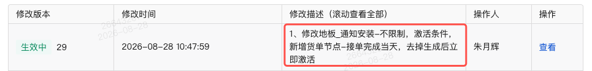

# 北京大宅-排程侧新增14个任务类型-技术方案

> 🔗 飞书：https://beike.feishu.cn/docx/VvsNdIVKjoprIyxYzbOcW6uCnbK （飞书为权威版本，本地为快照；md 更新后需手动同步）

## 1、背景[必选]

- 需求文档：[2026_【需求中】北京大宅-递增规则与任务类型的增加](https://beike.feishu.cn/docx/WIxIdv7emoP0tMxFOMJcDPbpnKe)
- keones：https://ones.ke.com/project/requirement/50546646
- 父方案：[[10.工作/技术方案/北京大宅-递增规则与任务类型增加-技术方案]]（本文档为其 **改造点C** 的独立展开）
- 范围：**仅排程侧**，工期侧无改动

北京大宅排程作业当前任务类型覆盖量房、设计、复尺、进场、安装、各批次验收等节点，但**石材/地砖的打磨与结晶工序**尚未建模。该工序由主材（石材/地砖）供应商承接，工序内部存在"通知→施工→验收"的固定节奏，且其触发时机依赖主材到场与材料自流程下发，无法由排程侧独立决定。本期需在排程侧新增 14 个任务类型（打磨 7 步 + 结晶 7 步）并打通"材料自流程下发 → 排程任务生成 → 主材任务回收"链路。

## 2、需求理解[必选]

### 2.1 14 个新增任务类型

| # | 任务类型 |
|---|---|
| 1 | 通知打磨 |
| 2 | 打磨派单 |
| 3 | 打磨进场 |
| 4 | 打磨提交自检 |
| 5 | 打磨自检验收 |
| 6 | 打磨实地验收 |
| 7 | 打磨业主确认 |
| 8 | 通知结晶 |
| 9 | 结晶派单 |
| 10 | 结晶进场 |
| 11 | 结晶提交自检 |
| 12 | 结晶自检验收 |
| 13 | 结晶实地验收 |
| 14 | 结晶业主确认 |

### 2.2 与父方案的关系

父方案 [[10.工作/技术方案/北京大宅-递增规则与任务类型增加-技术方案]] 的改造点 A（按工艺项数量递增）/ B（按空间信息递增）涉及工期+排程两端的递增规则扩展；**改造点 C（本方案）仅排程侧**，与 A/B 无计算耦合，仅共享"排程配置层 + 排程生成"链路。可独立评审、独立上线。

## 3、现状

### 3.1 任务类型枚举体系

排程侧任务类型来源分三层，新类型需在多层协同扩展：

| 层 | 位置 | 作用 | 本工程引用处 |
|---|---|---|---|
| 材料侧枚举 | `com.ke.utopia.enumeration.TaskTypeEnum`（edar-starlord-base jar） | 主材任务类型：复尺、下单、安装、结晶、打磨等等 | `ProcessTaskAndMaterialTaskUtil.java:9` |
| 节点类型枚举 | `com.ke.utopia.enumeration.NodeTypeEnum`（edar-starlord-base jar） | 节点：20、60、80、85等等 | 同上 |
| 本工程常量 | `DeliveryProcessTaskTypeConstant`（`artisan-construction-base`） | 排程任务类型 String 常量 | 全局 |
| 映射 | `ProcessTaskAndMaterialTaskUtil.TASK_TYPE_MAP`（`:20-87`） | 主材 `taskType + nodeType` → `DeliveryProcessTaskTypeConstant` 常量 | `MaterialTaskNodeCompleteHandler` 回收时 |

### 3.2 主材任务回收链路

```
材料侧(edar-starlord)  ──kafka──▶  MaterialTaskNodeCompleteHandler(:21)
   bizType="material-task-node-complete"        │
                                                ▼
                   BusinessChangeMessageHandleServiceImpl
                   .handleMaterialTaskNodeFinish()(:1381)
                                                │
                                                ▼
                   ProcessTaskAndMaterialTaskUtil
                   .getProcessTaskByMaterialTaskNode()
                   ← TASK_TYPE_MAP(:20-87) 按 taskType+nodeType 映射
                                                │
                                                ▼
                   DeliveryProcessServiceImpl
                   .handleStartOrFinishDeliveryProcessTaskWithLock()(:1389)
                   (Redisson 分布式锁内重算)
                                                │
                                                ▼
                   TaskStatusRecycleMsg(:21) ──Kafka──▶ 调度中心
                   topic="delivery-process-task-change"
                   ProjectFulfillmentCenterMsgProducer.taskStatusChange()(:44)
```

## 4、详细设计

详细设计按以下四部分展开：①配置层加递增规则（411/412 扩展到材料流程配置）→ ②增加任务（14 个新任务类型）→ ③应用层（主材任务回收）→ ④可视化。

### 4.1 配置层：材料流程配置加递增规则（411/412）

> 父方案 [[10.工作/技术方案/北京大宅-递增规则与任务类型增加-技术方案]] 改造点 A/B 的递增规则（411 按工艺项数量 / 412 按空间信息）原仅在排程配置侧落地，**本期将其扩展到材料流程配置侧**，使主材流程节点（`nodeProcessType=INSTALL_PROCESS`）也支持 411/412 递增规则配置。

#### 4.1.1 字段（与排程侧完全一致）

材料流程配置接口入参/返回新增字段，**字段名、层级、含义与排程侧（父方案 3.6.2）完全一致**：

| 字段 | 类型 | 所属层级 | 用于 | 说明 |
|---|---|---|---|---|
| `spaceDimensionType` | Integer/tinyint | 递增规则 `NodePeriodCalculateRuleCfgParam/DTO` 的 `increaseSecondType` 同级 | 412 | 1个数 / 2面积，仅 412 |
| `increaseMode` | Integer/tinyint | 工艺命中 `PeriodCalculateHitCraftCfgParam/DTO` 的 `period` 同级 | 411 | 复用 `AreaIncreaseTypeEnum`：1区间 / 2递增 |
| `increaseType` | Integer | 递增规则 `NodePeriodCalculateRuleCfgParam/DTO` | 411/412 | 411=按工艺项数量 / 412=按空间信息（枚举已存在） |
| `increaseSecondType` | Integer | 递增规则 `NodePeriodCalculateRuleCfgParam/DTO` | 412 | 601卫生间 / 602洗衣房（空间枚举，父方案 3.3.1） |

### 4.2 增加任务：14 个新任务类型

#### 4.2.1 任务类型定义

14 个任务类型由上游 edar-starlord-base jar 新增枚举定义（与 `TaskTypeEnum.POLISH` / `TaskTypeEnum.CRYSTALLIZATION` 同源）

| # | 枚举名 | 主材 TaskType | nodeType | 排程taskType |
|---|---|---|---|---|
| 1 | `NOTICE_POLISH` | `TaskTypeEnum.POLISH` | 20 | `polish_notice` |
| 2 | `POLISH_DISPATCH` | `TaskTypeEnum.POLISH` | 40 | `polish_dispatch` |
| 3 | `ENTRY_POLISH` | `TaskTypeEnum.POLISH` | 50 | `polish_entry` |
| 4 | `SUBMIT_POLISH_SELF_INSPECTION` | `TaskTypeEnum.POLISH` | 60 | `polish_submit_self_inspection` |
| 5 | `POLISH_SELF_INSPECTION_ACCEPTANCE` | `TaskTypeEnum.POLISH` | 65 | `polish_self_inspection_acceptance` |
| 6 | `POLISH_ON_SITE_ACCEPTANCE` | `TaskTypeEnum.POLISH` | 80 | `polish_on_site_acceptance` |
| 7 | `POLISH_OWNER_CONFIRMATION` | `TaskTypeEnum.POLISH` | 85 | `polish_owner_confirmation` |
| 8 | `NOTICE_CRYSTALLIZATION` | `TaskTypeEnum.CRYSTALLIZATION` | 20 | `crystal_notice` |
| 9 | `CRYSTALLIZATION_DISPATCH` | `TaskTypeEnum.CRYSTALLIZATION` | 40 | `crystal_dispatch` |
| 10 | `ENTRY_CRYSTALLIZATION` | `TaskTypeEnum.CRYSTALLIZATION` | 50 | `crystal_entry` |
| 11 | `SUBMIT_CRYSTALLIZATION_SELF_INSPECTION` | `TaskTypeEnum.CRYSTALLIZATION` | 60 | `crystal_submit_self_inspection` |
| 12 | `CRYSTALLIZATION_SELF_INSPECTION_ACCEPTANCE` | `TaskTypeEnum.CRYSTALLIZATION` | 65 | `crystal_self_inspection_acceptance` |
| 13 | `CRYSTALLIZATION_ON_SITE_ACCEPTANCE` | `TaskTypeEnum.CRYSTALLIZATION` | 80 | `crystal_on_site_acceptance` |
| 14 | `CRYSTALLIZATION_OWNER_CONFIRMATION` | `TaskTypeEnum.CRYSTALLIZATION` | 85 | `crystal_owner_confirmation` |

#### 4.2.2 常量与映射

**(1) `DeliveryProcessTaskTypeConstant`（`artisan-construction-base`）新增 14 个 String 常量**（值见 4.2.1 表 taskType 列）。

**(2) `TASK_TYPE_MAP`（`ProcessTaskAndMaterialTaskUtil:20-87`）新增 14 条映射**（主材 `taskType + nodeType` → 排程 taskType）：

**(3) `TASK_SEARCH_TYPE` Map（`:200-271`）**：反查主材任务映射，新增 14 条条目（参考现有 `MATERIAL_TASK_SEARCH=12` 口径，均映射到 `MATERIAL_TASK_SEARCH`）。

#### 4.2.3 任务池配置

`DeliveryProcessTaskPoolCfg`（任务池配置）新增这 14 个任务

#### 4.2.4 Apollo affectTaskTypeMap

`delivery.affect.task.type`（`BusinessChangeMessageHandleServiceImpl:130`）配置通知类任务完成 → 后续进场任务的期望上门时间（上门时间落在进场任务上）：

```json
{
  "dispatch_foreman": "00004",
  "reconnaissance_work": "00004",
  "base_construction_scheduling": "base_construction_work",
  "base_appoint_worker": "base_construction_work",
  "notice_install": "install_entrance",
  "notice_delivery": "arrival",
  "notice_recheck": "recheck",
  "polish_notice": "polish_entry",
  "crystal_notice": "crystal_entry"
}
```

- `polish_notice` 完成 → 触发 `polish_entry`（打磨进场）期望上门时间计算
- `crystal_notice` 完成 → 触发 `crystal_entry`（结晶进场）期望上门时间计算

#### 4.2.5 Apollo materialRelationTaskMap（通知打磨/通知结晶 → 可上门时间）

`delivery.process.material.relation.task.map`（`DeliveryProcessCfgTemplateServiceImpl:182`，`Map<String, List<NodeAssessmentRuleApolloBO.SecondLevelAssessDTO>>`）配置通知类任务带出的关联任务（如 通知安装 → 可上门时间），供三处消费：

1. **考核规则下拉**（`DeliveryProcessCfgTemplateTransfer.materialToRuleSelectDTOS:1098`）：通知类任务选项下追加「xxx-可上门时间」二级项（`CAN_VISIT_TIME_DESC` 拼名）
2. **考核规则校验**（`ProcessNodeCheckUtil.verifyAssessmentResult:375`）：反查 map 把关联任务 code 转回原任务 code，校验依赖任务存在性
3. **流程复制**（`DeliveryProcessCfgUtil.generateProcessNodeCfgParams:68`）：品类自流程复制时同步带出关联任务

现有配置基础上新增 `polish_notice` / `crystal_notice` 两条：

```json
{
  "notice_recheck": [ { "code": "recheck_can_visit_time", "name": "可上门时间" } ],
  "entry_storage": [ { "code": "exit_storage", "name": "出仓" } ],
  "notice_delivery": [ { "code": "notice_delivery_can_visit_time", "name": "可上门时间" } ],
  "notice_install": [ { "code": "notice_install_can_visit_time", "name": "可上门时间" } ],
  "polish_notice": [ { "code": "polish_notice_can_visit_time", "name": "可上门时间" } ],
  "crystal_notice": [ { "code": "crystal_notice_can_visit_time", "name": "可上门时间" } ]
}
```

- `polish_notice`（通知打磨）→ 带出「打磨-可上门时间」（`polish_notice_can_visit_time`）
- `crystal_notice`（通知结晶）→ 带出「结晶-可上门时间」（`crystal_notice_can_visit_time`）
- 与 4.2.4 affectTaskTypeMap 呼应：`polish_notice`/`crystal_notice` 完成后触发对应进场任务的期望上门时间计算（`polish_entry`/`crystal_entry`），本配置提供页面配置入口与校验支持

### 4.3 应用层：主材任务回收

打磨 7 步 / 结晶 7 步为主材任务，完成状态由材料侧回传，复用 3.2 链路：

```
材料侧完成打磨某步 ──MQ(material-task-node-complete)──▶ MaterialTaskNodeCompleteHandler
  → TASK_TYPE_MAP: POLISH + nodeType → 对应排程 taskType（如 POLISH+START → polish_entry）
  → handleStartOrFinishDeliveryProcessTaskWithLock (重算)
  → TaskStatusRecycleMsg 回收状态到调度中心
```

### 4.4 排程材料考核

#### 4.4.1 排程考核常量与映射

| 任务名称 | 排程任务code | 考核任务code | ofc任务code |
|---|---|---|---|
| 通知打磨 | `polish_notice` | 22000 | 22000 |
| 通知打磨生成时间 | `task_generate` | 22000_generate | 22000 |
| 通知打磨激活时间 | `task_activate` | 22000_active | 22000 |
| 打磨-可上门时间 | `polish_notice_can_visit_time` | 1000016 | 22000 |
| 打磨派单 | `polish_dispatch` | 22010 | 22010 |
| 打磨派单生成时间 | `task_generate` | 22010_generate | 22010 |
| 打磨派单激活时间 | `task_activate` | 22010_active | 22010 |
| 打磨进场 | `polish_entry` | 22020 | 22020 |
| 打磨进场生成时间 | `task_generate` | 22020_generate | 22020 |
| 打磨进场激活时间 | `task_activate` | 22020_active | 22020 |
| 打磨提交自检 | `polish_submit_self_inspection` | 22030 | 22030 |
| 打磨提交自检生成时间 | `task_generate` | 22030_generate | 22030 |
| 打磨提交自检激活时间 | `task_activate` | 22030_active | 22030 |
| 打磨自检验收 | `polish_self_inspection_acceptance` | 22040 | 22040 |
| 打磨自检验收生成时间 | `task_generate` | 22040_generate | 22040 |
| 打磨自检验收激活时间 | `task_activate` | 22040_active | 22040 |
| 打磨实地验收 | `polish_on_site_acceptance` | 22050 | 22050 |
| 打磨实地验收生成时间 | `task_generate` | 22050_generate | 22050 |
| 打磨实地验收激活时间 | `task_activate` | 22050_active | 22050 |
| 打磨业主确认 | `polish_owner_confirmation` | 22060 | 22060 |
| 打磨业主确认生成时间 | `task_generate` | 22060_generate | 22060 |
| 打磨业主确认激活时间 | `task_activate` | 22060_active | 22060 |
| 通知结晶 | `crystal_notice` | 23000 | 23000 |
| 通知结晶生成时间 | `task_generate` | 23000_generate | 23000 |
| 通知结晶激活时间 | `task_activate` | 23000_active | 23000 |
| 结晶-可上门时间 | `crystal_notice_can_visit_time` | 1000017 | 23000 |
| 结晶派单 | `crystal_dispatch` | 23010 | 23010 |
| 结晶派单生成时间 | `task_generate` | 23010_generate | 23010 |
| 结晶派单激活时间 | `task_activate` | 23010_active | 23010 |
| 结晶进场 | `crystal_entry` | 23020 | 23020 |
| 结晶进场生成时间 | `task_generate` | 23020_generate | 23020 |
| 结晶进场激活时间 | `task_activate` | 23020_active | 23020 |
| 结晶提交自检 | `crystal_submit_self_inspection` | 23030 | 23030 |
| 结晶提交自检生成时间 | `task_generate` | 23030_generate | 23030 |
| 结晶提交自检激活时间 | `task_activate` | 23030_active | 23030 |
| 结晶自检验收 | `crystal_self_inspection_acceptance` | 23040 | 23040 |
| 结晶自检验收生成时间 | `task_generate` | 23040_generate | 23040 |
| 结晶自检验收激活时间 | `task_activate` | 23040_active | 23040 |
| 结晶实地验收 | `crystal_on_site_acceptance` | 23050 | 23050 |
| 结晶实地验收生成时间 | `task_generate` | 23050_generate | 23050 |
| 结晶实地验收激活时间 | `task_activate` | 23050_active | 23050 |
| 结晶业主确认 | `crystal_owner_confirmation` | 23060 | 23060 |
| 结晶业主确认生成时间 | `task_generate` | 23060_generate | 23060 |
| 结晶业主确认激活时间 | `task_activate` | 23060_active | 23060 |

#### ~~4.4.2 新任务返补考核规则~~

~~如支持返补，需要模仿安装apollo写死返补考核规则~~

#### ~~4.4.3 八合一考核常量与映射~~

~~如在历史八合一整装项目售卖大理石，则需要支持~~

### 4.5 排程日历可视化

#### 4.5.1 数据结构 & 关键判断

1. 货单 -> 施工包映射

原结构体Map<string, string>，key：货单号 + "pre/after"，value：施工包code

新结构体Map<string, string>，key：货单号 + taskType（看施工包具体怎么定义），value：施工包code

1. 业务逻辑判断

打磨、结晶任务走安装逻辑，涉及多处if逻辑判断

#### 4.5.2 新任务跳转

打磨、结晶跳转逻辑和安装任务跳转逻辑相同

## 5、接口改动

### 5.1 配置层

#### 5.1.1 材料流程配置递增规则（对应 4.1 节设计）

| # | 接口 | 接口文档 | 改动 | 估时 |
|---|---|---|---|---|
| 1 | 查询材料详情 `api/construction/delivery-process-cfg-template/pool-tasks/material` | https://weapons.ke.com/project/1388/interface/api/1982548 | 增加新增递增规则字段 | |
| 2 | 材料变更提醒 `material-process/change/remind` | 待提供 | 增加对比按空间、人工分项量递增规则的diff | |
| 3 | 查询递增规则枚举 `queryStageIncreaseTypes` | 无 | 去掉按卫生间个数递增规则 | |
| 4 | 排程修改记录（见下图） | 无 | 增加对安装新增的激活条件的 diff 展示，同货单节点条件（`ActivateModeEnum.TASK_NODE`） | |


*排程修改记录示例：材料流程配置递增规则的修改记录（版本29，生效中，修改描述含"地板_通知安装 - 不限制，激活条件，新增货单节点 - 接单完成当天，去掉生成后立即激活"等内容）*

#### 5.1.2 应用层

| # | 入口类型 | 接口 / 消息 | 改动点 |
|---|---|---|---|
| 1 | HTTP | `POST /api/construction/delivery-process/create` | ① 4.2.2 常量与映射 ② 使用任务池二级类型判断货后任务 改为使用一级任务类型判断货后任务 |
| 2 | HTTP | `POST /api/construction/delivery-process/change` | ① 4.2.2 常量与映射 ② 使用任务池二级类型判断货后任务 改为使用一级任务类型判断货后任务 |
| 3 | 消息 | `oms#order-changed`（ScmOrderChangedHandler） | ① 4.2.2 常量与映射 ② 使用任务池二级类型判断货后任务 改为使用一级任务类型判断货后任务 |
| 4 | 消息 | `material-task-node-complete`（MaterialTaskNodeCompleteHandler） | ① 4.2.2 常量与映射（TASK_TYPE_MAP 新增 14 条） ② 4.2.4 affectTaskTypeMap 配置 polish_notice→polish_dispatch 等 |

## 6、上游依赖

本方案依赖材料侧（edar-starlord）团队发版/提供以下内容，卡上线关键路径：

| # | 依赖方 | 接口 / 位置 | 说明 |
|---|---|---|---|
| 1 | edar-starlord-base jar | `com.ke.utopia.enumeration.TaskTypeEnum`（edar-starlord-base jar） | 新增 任务枚举 |
| 2 | edar-starlord 服务 | `com.ke.utopia.api.deliveryflow.CategoryProcessFeign#categoryProcessInfo`（Feign，`POST /category/process/info`） | 新增新的递增规则字段 |
| 3 | utopia-cube | /package/construction/query_by_order_nos <br/>com.ke.utopia.cube.api.v2.pc.PackageQueryFeignService#queryPackageByOrderNos | 货单查询对应施工包信息 - 返回增加任务类型（新字段，改枚举均可） |
| 4 | utopia-cube | /pc/batchQuery/packageConstructionInfo <br/>com.ke.utopia.cube.api.v2.pc.PackageQueryV2Feign#batchQueryPackageConstruction | 施工包code查询施工包信息 - 返回增加任务类型（新字段，改枚举均可） |

## 7、表结构改动

任务池配置表 `artisan.delivery_process_task_pool_cfg` 新增 14 行配置数据（仿现有 `install_work` 口径，去掉 id / ctime / mtime / creator 相关字段；`one_level_type` / `two_level_type` 均为 `install`，`sort` 取枚举 sort 值）：

```SQL
INSERT INTO artisan.delivery_process_task_pool_cfg
 (task_type, unified_task_type, task_name, one_level_type, two_level_type, node_process_type, inside_outside_type, task_group, support_type, sort, time_rule, state)
 VALUES
 ('polish_notice',                            'polish_notice',                            '通知打磨',         'install', 'install', 4, 1, 'material', '', 150, 0, 1),
 ('polish_dispatch',                           'polish_dispatch',                          '打磨派单',         'install', 'install', 4, 1, 'material', '', 160, 0, 1),
 ('polish_entry',                              'polish_entry',                             '打磨进场',         'install', 'install', 4, 1, 'material', '', 170, 0, 1),
 ('polish_submit_self_inspection',            'polish_submit_self_inspection',            '打磨提交自检',     'install', 'install', 4, 1, 'material', '', 180, 0, 1),
 ('polish_self_inspection_acceptance',        'polish_self_inspection_acceptance',        '打磨自检验收',     'install', 'install', 4, 1, 'material', '', 190, 0, 1),
 ('polish_on_site_acceptance',                'polish_on_site_acceptance',                '打磨实地验收',     'install', 'install', 4, 1, 'material', '', 200, 0, 1),
 ('polish_owner_confirmation',                 'polish_owner_confirmation',                 '打磨业主确认',     'install', 'install', 4, 1, 'material', '', 210, 0, 1),
 ('crystal_notice',                    'crystal_notice',                   '通知结晶',         'install', 'install', 4, 1, 'material', '', 220, 0, 1),
 ('crystal_dispatch',                  'crystal_dispatch',                 '结晶派单',         'install', 'install', 4, 1, 'material', '', 230, 0, 1),
 ('crystal_entry',                     'crystal_entry',                    '结晶进场',         'install', 'install', 4, 1, 'material', '', 240, 0, 1),
 ('crystal_submit_self_inspection',   'crystal_submit_self_inspection',   '结晶提交自检',     'install', 'install', 4, 1, 'material', '', 250, 0, 1),
 ('crystal_self_inspection_acceptance','crystal_self_inspection_acceptance','结晶自检验收',     'install', 'install', 4, 1, 'material', '', 260, 0, 1),
 ('crystal_on_site_acceptance',       'crystal_on_site_acceptance',       '结晶实地验收',     'install', 'install', 4, 1, 'material', '', 270, 0, 1),
 ('crystal_owner_confirmation',       'crystal_owner_confirmation',       '结晶业主确认',     'install', 'install', 4, 1, 'material', '', 280, 0, 1);
```

考核任务映射scm-workbench的indicator_base_event待确认主材任务taskType后，再完善SQL

```SQL
INSERT INTO `indicator_base_event` (`code`, `schedule_code`, `event_name`, `event_type`, `task_info`, `time_type`, `is_delete`)
VALUES
        ('22000', 'polish_notice', '通知打磨', 2, '21_20', 3, 0),
        ('22000_generate', 'task_generate', '通知打磨生成时间', 2, '21_20', 2, 0),
        ('22000_active', 'task_activate', '通知打磨激活时间', 2, '21_20', 4, 0),
        ('1000016', 'polish_notice_can_visit_time', '打磨-可上门时间', 2, '21_20', 1, 0),
        ('22010', 'polish_dispatch', '打磨派单', 2, '21_40', 3, 0),
        ('22010_generate', 'task_generate', '打磨派单生成时间', 2, '21_40', 2, 0),
        ('22010_active', 'task_activate', '打磨派单激活时间', 2, '21_40', 4, 0),
        ('22020', 'polish_entry', '打磨进场', 2, '21_50', 3, 0),
        ('22020_generate', 'task_generate', '打磨进场生成时间', 2, '21_50', 2, 0),
        ('22020_active', 'task_activate', '打磨进场激活时间', 2, '21_50', 4, 0),
        ('22030', 'polish_submit_self_inspection', '打磨提交自检', 2, '21_60', 3, 0),
        ('22030_generate', 'task_generate', '打磨提交自检生成时间', 2, '21_60', 2, 0),
        ('22030_active', 'task_activate', '打磨提交自检激活时间', 2, '21_60', 4, 0),
        ('22040', 'polish_self_inspection_acceptance', '打磨自检验收', 2, '21_65', 3, 0),
        ('22040_generate', 'task_generate', '打磨自检验收生成时间', 2, '21_65', 2, 0),
        ('22040_active', 'task_activate', '打磨自检验收激活时间', 2, '21_65', 4, 0),
        ('22050', 'polish_on_site_acceptance', '打磨实地验收', 2, '21_80', 3, 0),
        ('22050_generate', 'task_generate', '打磨实地验收生成时间', 2, '21_80', 2, 0),
        ('22050_active', 'task_activate', '打磨实地验收激活时间', 2, '21_80', 4, 0),
        ('22060', 'polish_owner_confirmation', '打磨业主确认', 2, '21_85', 3, 0),
        ('22060_generate', 'task_generate', '打磨业主确认生成时间', 2, '21_85', 2, 0),
        ('22060_active', 'task_activate', '打磨业主确认激活时间', 2, '21_85', 4, 0),
        ('23000', 'crystal_notice', '通知结晶', 2, '22_20', 3, 0),
        ('23000_generate', 'task_generate', '通知结晶生成时间', 2, '22_20', 2, 0),
        ('23000_active', 'task_activate', '通知结晶激活时间', 2, '22_20', 4, 0),
        ('1000017', 'crystal_notice_can_visit_time', '结晶-可上门时间', 2, '22_20', 1, 0),
        ('23010', 'crystal_dispatch', '结晶派单', 2, '22_40', 3, 0),
        ('23010_generate', 'task_generate', '结晶派单生成时间', 2, '22_40', 2, 0),
        ('23010_active', 'task_activate', '结晶派单激活时间', 2, '22_40', 4, 0),
        ('23020', 'crystal_entry', '结晶进场', 2, '22_50', 3, 0),
        ('23020_generate', 'task_generate', '结晶进场生成时间', 2, '22_50', 2, 0),
        ('23020_active', 'task_activate', '结晶进场激活时间', 2, '22_50', 4, 0),
        ('23030', 'crystal_submit_self_inspection', '结晶提交自检', 2, '22_60', 3, 0),
        ('23030_generate', 'task_generate', '结晶提交自检生成时间', 2, '22_60', 2, 0),
        ('23030_active', 'task_activate', '结晶提交自检激活时间', 2, '22_60', 4, 0),
        ('23040', 'crystal_self_inspection_acceptance', '结晶自检验收', 2, '22_65', 3, 0),
        ('23040_generate', 'task_generate', '结晶自检验收生成时间', 2, '22_65', 2, 0),
        ('23040_active', 'task_activate', '结晶自检验收激活时间', 2, '22_65', 4, 0),
        ('23050', 'crystal_on_site_acceptance', '结晶实地验收', 2, '22_80', 3, 0),
        ('23050_generate', 'task_generate', '结晶实地验收生成时间', 2, '22_80', 2, 0),
        ('23050_active', 'task_activate', '结晶实地验收激活时间', 2, '22_80', 4, 0),
        ('23060', 'crystal_owner_confirmation', '结晶业主确认', 2, '22_85', 3, 0),
        ('23060_generate', 'task_generate', '结晶业主确认生成时间', 2, '22_85', 2, 0),
        ('23060_active', 'task_activate', '结晶业主确认激活时间', 2, '22_85', 4, 0);
```

## 8、风险评估及对其它系统影响

无

## 9、Check List

> 评审前自查，评审时复核。
>
> 分支：feat/50546646/material_villa

- [ ] 整体评估

- [ ] 上线
  - [ ] 上线顺序：edar-starlord-base 发版 → 本工程发布 → Apollo 配置 → 任务池配置 → 启用 411/412 对比分支
  - [ ] 回滚：删除 14 条映射 + Apollo 配置 + 重新注释 411/412 对比分支，无 DB schema 改动

## 10、评审会议纪要

### 参会人员

QA:
开发:

### Todo List

> 记录评审改进意见。
